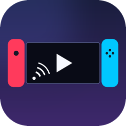

<p align="center">
  
</p>

<h1 align="center">SwitchCast / Switch 投屏</h1>

<p align="center">
  <b>中文</b> | <a href="#english">English</a>
</p>

<p align="center">
  
  
  
  
</p>
<p align="center">
  
  
  
  <a href="https://github.com/hwl513782273/SwitchCast/releases/latest"></a>
</p>

---

<p align="center">
  <a href="https://github.com/hwl513782273/SwitchCast/releases/latest">下载最新版 / Download</a>
  ·
  <a href="https://github.com/hwl513782273/SwitchCast/issues">问题反馈 / Issues</a>
</p>

> 把 Nintendo Switch 画面低延迟接到 Mac 的原生客户端：USB 直连或局域网 TCP Bridge，VideoToolbox 硬解 720p30，支持截图与录屏，零第三方二进制依赖 / A native macOS client that streams your Nintendo Switch over USB or LAN with hardware decoding, screenshots and recording, and zero third-party binaries.
>
> **作者 Author：banqiu** **许可证 License：GPL-2.0**（详见 LICENSE）。本项目基于 [exelix11/SysDVR](https://github.com/exelix11/SysDVR) 的公开协议实现，同样以 GPL-2.0 发布，须保留版权与许可声明。

## 中文

### 主要功能

- **连上就出画面**：启动默认走 USB，插线即识别（直接列出 `SysDVR|版本|协议|序列号`）；也可切网络模式，自动发现局域网主机并把 IP 填好。
- **硬件解码**：VideoToolbox 直接解 H.264 720p30；音频按 48kHz 立体声 PCM 转 float 交给 AVAudioEngine，音画走独立通道，互不阻塞。
- **真正的全屏**：不是把窗口放大，而是独立无边框窗口铺满屏幕，只留游戏画面；控制条 2.5 秒无操作自动淡出，Esc 退出。
- **截图与录屏**：截图存 PNG 到桌面；录屏存 MP4 到「影片」（目录可改），视频走 H.264 直通不重编码，音轨可选有无。
- **状态一眼可见**：分辨率、帧率、码率、累计帧数、协议版本、运行时长，外加带时间戳的运行日志，连不上时能直接看出卡在哪一步。
- **零依赖原生实现**：Swift + SwiftUI 直编，不用 FFmpeg / SDL2 / libusb 等任何外部动态库，DMG 约 1 MB，拖进「应用程序」即可。

> **平台说明 Platform Note：本工具为 macOS 原生应用（SwiftUI + AppKit，打包为 `.app` / `.dmg`），暂无 Windows / Linux 版本。**

**来源与致谢**：本项目的协议实现参考 [exelix11/SysDVR](https://github.com/exelix11/SysDVR)（GPL-2.0）公开的 `protocol.md` 与 sysmodule 源码，为独立的 Swift 原生重写（不包含其 C# 客户端代码），并按 GPL-2.0 条款发布。

### 快速开始

1. 在 [Releases](https://github.com/hwl513782273/SwitchCast/releases/latest) 下载 DMG。
2. 打开 DMG，把 `SwitchCast.app` 拖入「应用程序」。
3. 首次打开：右键 → 打开（或终端执行 `xattr -dr com.apple.quarantine /Applications/SwitchCast.app`）。
4. Switch 端装好 SysDVR 并把模式设为 USB（或 TCP Bridge），插线/联网后点应用首屏列出的设备即可出画面。

从源码构建（需 macOS 12+ 与 Xcode 命令行工具）：

```
xcode-select --install
git clone https://github.com/hwl513782273/SwitchCast.git
cd SwitchCast
./build.sh
```

打包 DMG（需 macOS 自带 hdiutil，无额外依赖）：

```
./make_dmg.sh
# 产物：12-SwitchCast-1.0.11-universal.dmg
```

### macOS 版本选择

- **Apple Silicon（M1 及更新）— 推荐**：下载 `12-SwitchCast-1.0.11-universal.dmg`（通用二进制，Intel 机型同样可用）。
- **Intel Mac**：同样使用 `12-SwitchCast-1.0.11-universal.dmg`（内含 x86_64 切片）。

> 各档 DMG 均为 ad-hoc 签名、**未公证（notarized）**，首次打开请右键「打开」放行 Gatekeeper；本应用不联网、不收集任何数据。

> 仓库「发行版 / Releases」的命名格式为：`支持最低版本-SwitchCast-版本-架构`（如 `12-SwitchCast-1.0.11-universal.dmg`）。第一段数字为该包实际支持的最低 macOS 版本号。

### 支持的功能

| 类别 | 项目 | 说明 |
|------|------|------|
| 传输 | USB 直连 | 走 IOUSBHost 访问 sysmodule 暴露的 bulk 端点，仅掌机模式可用，延迟最低 |
| 传输 | 网络 TCP Bridge | 连接 9911（视频）/ 9922（音频），支持 UDP 19999 自动发现与手填 IP |
| 解码 | H.264 720p30 | VideoToolbox 硬件解码，VideoToolbox 不可用时回退软解 |
| 音频 | PCM 48kHz 立体声 | int16 转 float 播放，带 450ms 积压保护，可静音/调音量/热切开关 |
| 输出 | 截图 | 保存 PNG（1280×720 原始分辨率）到桌面 |
| 输出 | 录屏 | MP4，视频 H.264 直通、音频可选 AAC 160kbps，目录默认「影片」可改 |
| 交互 | 沉浸全屏 | 无边框铺满屏幕、控制条自动淡出、Esc 退出 |

### 差异化亮点

- 🎯 **不为「能跑」付学费**：官方客户端在 macOS 上要拖 4 个外部 dylib、还得手动重签才能过 Gatekeeper；这里一个 `.app` 就是全部。
- ⚡ **直通录制不重编码**：录屏直接复用解码前的压缩帧写进 MP4，CPU 占用几乎为零，画质和串流完全一致。
- 🖥️ **真·全屏**：独立无边框窗口铺满，标题栏、侧栏、菜单栏一起让位，只留游戏。
- 🔌 **USB 优先**：默认就选 USB 通道，插线即用；USB 不可用时再走局域网，自动发现免手填 IP。
- 🩺 **故障可见**：连接、握手、端点、解码逐级打日志，失败时直接告诉你卡在哪一环，而不是只给一个黑屏。

### 已知限制

- **只有 720p30**：这是 Switch 硬件编码器的上限，不是客户端丢帧；音频固定 16bit/48kHz 未压缩。
- **只抓游戏画面**：系统界面、首页、以 applet 方式运行的自制程序不会被捕获；未开启录像功能的游戏需另装 [dvr-patches](https://github.com/exelix11/dvr-patches)。
- **USB 不能插底座**：底座模式下该数据通道不可用，请用掌机状态 + USB-A→C 线；若握手超时，多为 Switch 端 SysDVR 未处于 USB 模式或主机休眠。
- **未公证**：应用为 ad-hoc 签名，首次启动需右键「打开」放行；请只从本仓库 Releases 获取。

## English

### Highlights

- **Plug and play**: USB is the default transport, and attached devices show up immediately with their `SysDVR|version|protocol|serial` descriptor; the network mode auto-discovers consoles and fills in the IP for you.
- **Hardware decoding**: H.264 720p30 is decoded by VideoToolbox, while 48 kHz stereo PCM is converted to float and played through AVAudioEngine — video and audio never block each other.
- **Real fullscreen**: a dedicated borderless window covers the screen with nothing but the game; the control bar fades out after 2.5 s idle and Esc returns.
- **Screenshots and recording**: PNG screenshots to the Desktop, MP4 recordings to Movies (configurable), with H.264 passthrough so nothing is re-encoded and an optional AAC audio track.
- **Visible health**: resolution, fps, bitrate, frame count, protocol version and runtime, plus a timestamped log that tells you exactly which step failed.
- **Zero dependencies**: built with Swift and SwiftUI, no FFmpeg / SDL2 / libusb, so the DMG is about 1 MB and drag-to-Applications is all it takes.

> **Platform Note: this is a native macOS app (SwiftUI + AppKit, packaged as `.app` / `.dmg`). There is no Windows / Linux build.**

**Credits**: the protocol implementation follows the public `protocol.md` and sysmodule sources of [exelix11/SysDVR](https://github.com/exelix11/SysDVR) (GPL-2.0). This is an independent native Swift rewrite that contains none of its C# client code, released under the same GPL-2.0 terms.

### Quick start

1. Download the DMG from [Releases](https://github.com/hwl513782273/SwitchCast/releases/latest).
2. Open the DMG and drag `SwitchCast.app` into "Applications".
3. First launch: right-click → Open (or run `xattr -dr com.apple.quarantine /Applications/SwitchCast.app`).
4. Set SysDVR on the console to USB (or TCP Bridge), connect the cable or join the same network, then click the device listed on the start screen.

Build from source (requires macOS 12+ and the Xcode command line tools):

```
xcode-select --install
git clone https://github.com/hwl513782273/SwitchCast.git
cd SwitchCast
./build.sh
```

Package the DMG (uses the built-in hdiutil, no extra dependency):

```
./make_dmg.sh
# output: 12-SwitchCast-1.0.11-universal.dmg
```

### Choose a macOS build

- **Apple Silicon (M1 and later) — Recommended**: download `12-SwitchCast-1.0.11-universal.dmg` (universal binary, also runs on Intel).
- **Intel Mac**: the same `12-SwitchCast-1.0.11-universal.dmg` (contains the x86_64 slice).

> All DMGs are ad-hoc signed and **not notarized**. Right-click → Open on first launch to pass Gatekeeper. The app never phones home and collects nothing.

> Release naming format: `minimum-macOS-version-SwitchCast-version-arch` (e.g. `12-SwitchCast-1.0.11-universal.dmg`).

### Supported features

| Category | Item | Description |
|----------|------|-------------|
| Transport | USB | Talks to the bulk endpoints exposed by the sysmodule through IOUSBHost, handheld mode only, lowest latency |
| Transport | Network TCP Bridge | Connects to 9911 (video) / 9922 (audio), with UDP 19999 discovery or a manual IP |
| Decoding | H.264 720p30 | VideoToolbox hardware decoding with a software fallback |
| Audio | PCM 48 kHz stereo | int16 to float playback with a 450 ms backlog guard, mute / volume / live toggle |
| Output | Screenshot | PNG at the native 1280×720 resolution, saved to the Desktop |
| Output | Recording | MP4 with H.264 passthrough and optional AAC 160 kbps, saved to Movies by default |
| Interaction | Immersive fullscreen | Borderless full-screen, auto-hiding controls, Esc to exit |

### Why this tool

- 🎯 **No Gatekeeper tax**: the vendor client ships four external dylibs and needs manual re-signing on macOS; here a single `.app` is the whole story.
- ⚡ **Recording without re-encoding**: recordings reuse the compressed frames captured before decoding, so CPU cost is near zero and quality matches the stream.
- 🖥️ **Fullscreen means fullscreen**: a borderless window covers everything — title bar, sidebar and menu bar step aside for the game.
- 🔌 **USB first**: USB is the default transport, and LAN discovery is the fallback when USB is unavailable.
- 🩺 **Failures are legible**: connection, handshake, endpoints and decoding are all logged step by step, so you see where it stopped instead of a black frame.

### Known limitations

- **720p30 only**: that is the Switch hardware encoder limit, not client-side dropping; audio is fixed at uncompressed 16-bit/48 kHz.
- **Game output only**: the system UI, home menu and applets are not captured; titles without video recording enabled need [dvr-patches](https://github.com/exelix11/dvr-patches).
- **No USB while docked**: use handheld mode with a USB-A to USB-C cable; a handshake timeout usually means SysDVR is not in USB mode or the console is asleep.
- **Not notarized**: the app is ad-hoc signed; right-click → Open on first launch and only download it from this repository's Releases.

## 隐私与安全 / Privacy and security

- 全部处理都在本机完成：不解析域名、不上传画面、不收集任何遥测数据，唯一的网络行为是连接你指定的 Switch 主机 / Everything runs locally: no telemetry, no uploads, and the only network traffic is the connection to the console you point it at.
- 需要「本地网络」权限才能收发局域网广播；录屏与截图只写入你自己选择的目录 / The app asks for Local Network permission to receive discovery broadcasts, and files are only written to the folders you choose.
- 应用未公证（notarized），请仅从本仓库 Releases 获取并在首次打开时右键放行 / The app is not notarized; download it only from this repository's Releases and right-click → Open on first launch.

## 许可证 / License

> **GPL-2.0 License** — 版权归 **banqiu** 所有（2026）。
>
> - 本项目基于 [exelix11/SysDVR](https://github.com/exelix11/SysDVR)（GPL-2.0）公开的协议文档与 sysmodule 源码实现，作为衍生作品同样以 GNU General Public License v2.0 发布。
> - 允许个人与商业免费使用、修改、再分发，须保留版权与许可声明，并且分发衍生作品时同样以 GPL-2.0 开源。
> - 完整条款见 [LICENSE](https://github.com/hwl513782273/SwitchCast/blob/main/LICENSE)。

## 支持 / Support

SwitchCast 是一款免费开源工具，基于 GPL-2.0 许可发布，离线运行、无广告、无内购。如果你觉得好用，欢迎在 GitHub 上点个 Star，或反馈问题 / 提交 PR 帮它变得更好 —— 纯自愿。 SwitchCast is free, open-source (GPL-2.0), offline and ad-free. If it helps you, a GitHub Star or an issue/PR is warmly welcome — entirely optional.
